# Decision models: architecture review and decision record

**Status:** independent architecture review with source-pinned implementation and local CPU checkpoints. The original inventory below is pinned to its audited revision. Native provider adapters, a separate decision profile/UI, frozen consumers and durable acceptance checks have since landed; live provider and classifier-quality acceptance remain distinct from those checks.

**Implementation checkpoint (2026-10-30):** core `520195d`, review corrections `b188e56` and durable admission/receipt/revocation/actual-PostgreSQL tests `978b6f6` implement the central port. The independent review identified and confirmed source fixes for Jev literal response types, exact score legends and argmax consistency, unscored structured answers abstaining instead of bypassing certainty policy, and honest provider-reported unresolved model aliases. SQL project/principal budgets count every actual attempt; cached/idempotent responses do not start a new attempt. SHA receipts bind request/input/artifact version, and revoked membership discards the answer before publication. The implementation owner reports nineteen native HTTP/SDK/SQLite/actual-PG cases including SIGKILL recovery; the reviewer inspected these critical source paths without independently rerunning that process-death suite.

Conversation eligibility now uses native finite decisions before the selected generative harness writes an offer. Visual possibility/comprehension/type, spike usefulness and automatic participation use the independent frozen profile, while explicit mentions bypass optional suppression. Semantic selected-passage design-gap reviews retain probability, score/confidence, abstention, source staleness and attributed discussion without granting approval. The [four-case full-App receipt](studio-evidence/continuation/full-product/README.md) at `28ea384` includes the separate provider/model/threshold picker, actual native HTTP fixtures and persisted uncertainty/provenance. It does not demonstrate paid live inference or classifier accuracy. Registration changes that alter tenant/credential scope must bump `STUDIO_DECISION_CONFIG_REVISION`; consumers must fence publication against their captured source, since the service may evaluate an explicit historical snapshot.

**Local CPU checkpoint (2026-10-30):** the user rejected Gateway use and credit purchase. The default independent decision profile is now `llama-cpp-cpu / qwen2.5-0.5b-instruct-q4-k-m`, source `778d738`; the [actual seven-test receipt](../packages/studio/verification/evidence/local-decisions.json) covers native inference plus authenticated API, SQLite and PostgreSQL persistence. Both authoring and decisions use downloaded free weights, with separate profiles: managed native T3/OpenCode is the default authoring composition at `5608a3a`, while finite decisions share its one bounded CPU-model process without becoming generative authoring calls. No Gateway inference or implicit provider fallback is authorized.

The [local adapter](studio-local-decisions.md) resolves the real model chat wrapper and measures native label-token likelihoods. It replaces the earlier generic native MCQ/NOUL prompt that exhibited letter-order bias. Its vectors are **conditional option likelihoods with `calibrated:false`**, not calibrated correctness or generated self-ratings. Boolean polarity, finite intent/color choices and explicit release-risk bins pass the small corpus; more complex coverage rubrics abstain at `.7` and preserve their distributions, including the observed intermediate-bin ranking on the complete example. Full input must fit 4096 tokens and the 12,000-byte admission bound; overflow fails rather than truncating. Immutable SHA/runtime/adapter identity joins frozen configuration and cache keys; receipts include actual usage and sampled peak RSS. These local tests do not establish broad accuracy, hosted local-model acceptance or any authority to approve, authorize or prove.

**Audited application revision:** [`998defa8e44028d877aea3952e70f9d024b3b7ce`](https://github.com/Tyler-R-Kendrick/ai-bdd/tree/998defa8e44028d877aea3952e70f9d024b3b7ce), inspected on 2026-10-30. This includes explicit artifact T3/fx/remote-Planner profiles. The initial audit began at `18054388d44223a4f7237032f339b741979b3477`; findings were reconciled against the later pinned revision. Core files may advance after this record. Public contracts below are pinned independently.

## Finding and architectural decision

Add a provider-neutral **DecisionModel** boundary and a separately persisted **decision provider/model selection per artifact**. Use it for bounded semantic predicates, choices, and rubric scores. Keep the artifact's existing authoring harness/provider/model selection independent. T3, fx, and remote Planner remain authoring choices; selecting one must not silently select, replace, or authenticate a decision provider.

The current source has three strong immediate consumers: conversation offer detection, three-stage paragraph visual routing, and speculative prototype usefulness. It also has meaningful gaps where decision models can help: semantic design-gap assessment, automatic participation relevance, candidate relevance/novelty checks, and optional task/routing recommendations. This is more than renaming `generateText` calls: several existing outputs contain prose that a decision API cannot generate.

A decision model estimates a fact or selects among application-provided alternatives. It cannot authorize a tool, supply human consent, accept an ADR, approve a Build graph, discharge a required investigation, certify evidence, or establish a formal proof. Those remain deterministic, authenticated state transitions. Low confidence, refusal, missing configuration, invalid output, and timeout are distinct outcomes, never permission to proceed.

## What the audited baseline did

The links in this table point to the audited application revision. This inventory follows the model calls, their admission/publication paths, and adjacent policy. A method named `decide` is not automatically a model call: `InvestigationService.decide`, for example, records an attributed conclusion over a specific evidence selection.

| Path / function                                                                                                                                                                                                                                                                                                                                                        | Present behavior and evidence                                                                                                                                                                                                                                                                                                                                                                                                                                                                       | Appropriate decision-model boundary                                                                                                                                                                                                                                                                                                                                                                                                                                               |
| ---------------------------------------------------------------------------------------------------------------------------------------------------------------------------------------------------------------------------------------------------------------------------------------------------------------------------------------------------------------------- | --------------------------------------------------------------------------------------------------------------------------------------------------------------------------------------------------------------------------------------------------------------------------------------------------------------------------------------------------------------------------------------------------------------------------------------------------------------------------------------------------- | --------------------------------------------------------------------------------------------------------------------------------------------------------------------------------------------------------------------------------------------------------------------------------------------------------------------------------------------------------------------------------------------------------------------------------------------------------------------------------- |
| [Conversation extraction](https://github.com/Tyler-R-Kendrick/ai-bdd/blob/998defa8e44028d877aea3952e70f9d024b3b7ce/packages/studio/server/integrations/conversation.ts#L239)                                                                                                                                                                                           | A durable `conversation.extract` job calls `generateText` with the global Gateway model and a schema containing up to four decision/research offers. Its source freezes the artifact version/content hash, twelve bounded messages, and accepted decision identities/versions. It validates actual message IDs, verbatim source quotation, distinct options, and the current source again before publication. The generated offer contains title, rationale, question, options, and research brief. | Separate semantic detection from offer writing. A decision provider can identify an unresolved choice, external evidence need, relevance, or duplication. A generative provider writes the question/options/brief. Preserve the existing citation and stale-source checks. The current job does not freeze an independent decision profile; reading global model settings at execution is the wrong long-term boundary.                                                           |
| [Paragraph target selection](https://github.com/Tyler-R-Kendrick/ai-bdd/blob/998defa8e44028d877aea3952e70f9d024b3b7ce/packages/studio/server/integrations/visual-routing.ts#L21)                                                                                                                                                                                       | `visualTarget` deterministically restricts document kinds, request length, optional `#block:` target, paragraph length, stable block identity, and block hash. It chooses a bounded paragraph. Agent admission restricts this to enabled explicit/member-addressed turns and freezes the target.                                                                                                                                                                                                    | Keep explicit targeting and bounds deterministic. Optional semantic ranking may choose among a small supplied set of eligible paragraph IDs; it must not silently change an explicit block target or expand the private source context.                                                                                                                                                                                                                                           |
| [Visual possibility, comprehension, type, and authoring](https://github.com/Tyler-R-Kendrick/ai-bdd/blob/998defa8e44028d877aea3952e70f9d024b3b7ce/packages/studio/server/integrations/visual-routing.ts#L50)                                                                                                                                                           | Four saved model steps share the authoring language-model path: possibility boolean/reason; comprehension boolean/reason; chart/diagram/tabs/none choice; then schema-bound visual content generation. The block digest fences insertion.                                                                                                                                                                                                                                                           | Move the first three bounded decisions to DecisionModel. Preserve staged short-circuiting and `none`/prose. Keep visual authoring on the frozen authoring profile. Native decision APIs do not supply the existing free-form reasons. Type/schema validity does not prove chart values came from the paragraph: preserve source-fact references and reject unsupported values, with human proposal review retained.                                                               |
| [Speculative spikes](https://github.com/Tyler-R-Kendrick/ai-bdd/blob/998defa8e44028d877aea3952e70f9d024b3b7ce/packages/studio/server/integrations/spikes.ts#L20)                                                                                                                                                                                                       | `createSpikeJudge` combines `{ useful, brief, reason }` in one global-model structured output. Saved passages enter a SQL debounce lane, freeze through a durable step, and face source checks plus per-document/person classification budgets. `considerSpike` then rechecks source, personal machine consent, live machine status, duplicate passage identity, and execution quotas before admitting work.                                                                                        | The usefulness predicate belongs on DecisionModel. Generating the exact prototype brief/rationale is a separate authoring step. A positive probability is only an input to the existing admission policy. Unavailable classification or synthesis must not manufacture a useful result or replay a machine side effect.                                                                                                                                                           |
| [Research retrieval](https://github.com/Tyler-R-Kendrick/ai-bdd/blob/998defa8e44028d877aea3952e70f9d024b3b7ce/packages/studio/server/integrations/research.ts#L12) and [agent research](https://github.com/Tyler-R-Kendrick/ai-bdd/blob/998defa8e44028d877aea3952e70f9d024b3b7ce/packages/studio/server/agent.ts#L850)                                                 | An explicit request supplies an exact bounded brief. The source service receives that brief, not the full artifact. Actual source URLs/excerpts are validated, deduplicated, hashed, and timestamped; synthesis uses the frozen authoring profile. Empty retrieval fails rather than publishing fabricated research.                                                                                                                                                                                | Do not classify away an explicit `/research` command or rewrite its approved brief. For automatic offers, classify whether research is useful and not already resolved; then synthesize an editable brief. Optional relevance/counterevidence scoring may rank a bounded list of retrieved source IDs. A relevance probability is not factual verification or proof that a source was retrieved.                                                                                  |
| [Automatic title maintenance](https://github.com/Tyler-R-Kendrick/ai-bdd/blob/998defa8e44028d877aea3952e70f9d024b3b7ce/packages/studio/server/integrations/titles.ts#L118) and [title generator](https://github.com/Tyler-R-Kendrick/ai-bdd/blob/998defa8e44028d877aea3952e70f9d024b3b7ce/packages/studio/server/agent.ts#L745)                                        | Title jobs freeze recent human messages, latest message ID, title, policy epoch, and selected authoring profile. They recheck automatic naming ownership, source version, latest message, participation eligibility, and the human-protected title before applying generated text.                                                                                                                                                                                                                  | A low-cost predicate can decide whether discussion materially warrants a title change, or compare a generated candidate to the current title. The title itself remains generative. Never let a classifier clear human ownership or bypass the epoch/current-title check. This is a lower priority than visual/spike/conversation classification.                                                                                                                                  |
| [Participation and scheduling](https://github.com/Tyler-R-Kendrick/ai-bdd/blob/998defa8e44028d877aea3952e70f9d024b3b7ce/packages/studio/server/agent.ts#L323)                                                                                                                                                                                                          | `observeMessage` uses an explicit mention regex, manual/automatic policy, pause state, latest message, and recent human count. Addressed turns have no delay; automatic turns use fixed solo/group delays. `canParticipate`, ownership leases, active implementation locks, and latest-message checks independently constrain execution.                                                                                                                                                            | Add semantic `respond / wait / stay_silent` advice for eligible automatic discussion. Use bounded recent turns and explicit criteria for unresolved requests, useful contribution, and ongoing human conversation. Explicit addressed requests need no suppression classifier. A model must not change pause, ownership, implementation lock, credentials, or the chosen harness.                                                                                                 |
| [Artifact authoring profiles](https://github.com/Tyler-R-Kendrick/ai-bdd/blob/998defa8e44028d877aea3952e70f9d024b3b7ce/packages/studio/server/integrations/agent-profiles.ts#L12) and [admission](https://github.com/Tyler-R-Kendrick/ai-bdd/blob/998defa8e44028d877aea3952e70f9d024b3b7ce/packages/studio/server/agent.ts#L430)                                       | Each artifact explicitly selects T3/fx/remote Planner, registered provider, and model. T3 is the default; unavailable configuration is visible and does not silently fall back. Admission freezes the profile before enqueue. Intent is an explicit chat/edit/research operation.                                                                                                                                                                                                                   | DecisionModel may recommend a suitable eligible capability or harness for a user request, with `keep_current` and `ask_user` outcomes. It must not silently replace that explicit selection, pick unregistered model IDs, reinterpret an explicit action, or enable missing configuration. A routing recommendation is not execution authorization.                                                                                                                               |
| [Agent tool loop](https://github.com/Tyler-R-Kendrick/ai-bdd/blob/998defa8e44028d877aea3952e70f9d024b3b7ce/packages/studio/server/agent.ts#L810)                                                                                                                                                                                                                       | The selected generative model can request a bounded set of read-only repository tools. The repository revision is pinned and source reads recheck authorized identity. The loop has explicit tool-step/output bounds.                                                                                                                                                                                                                                                                               | A decision model can advise whether a known read tool or source is relevant, or recommend escalation. Actual tool availability, repository access, path bounds, and network destinations remain server-enforced. Never turn a vendor's “safe tool call” probability into an ACL or automatic permission approval.                                                                                                                                                                 |
| [Implementation draft generation](https://github.com/Tyler-R-Kendrick/ai-bdd/blob/998defa8e44028d877aea3952e70f9d024b3b7ce/packages/studio/server/integrations/implementation-drafting.ts#L60) and [graph authoring](https://github.com/Tyler-R-Kendrick/ai-bdd/blob/998defa8e44028d877aea3952e70f9d024b3b7ce/packages/studio/server/agent.ts#L772)                    | A durable draft freezes bounded plan text, expected graph pointers, source revision, and authoring profile. Generation produces a full task DAG with acceptance criteria. Publication rechecks current source, participation, readiness, and graph revision. Drafting neither approves nor executes tasks.                                                                                                                                                                                          | Keep decomposition and criterion writing generative. Add decision-model advisories for missing acceptance coverage, underspecified tasks, dependency plausibility, task category, risk, and likely investigation needs. Every selected task/criterion must come from supplied stable IDs. DAG acyclicity, duplicate IDs, dependency scheduling, and approval stay deterministic.                                                                                                  |
| [Document readiness](https://github.com/Tyler-R-Kendrick/ai-bdd/blob/998defa8e44028d877aea3952e70f9d024b3b7ce/packages/studio/server/document-readiness.ts#L17), [graph approval](https://github.com/Tyler-R-Kendrick/ai-bdd/blob/998defa8e44028d877aea3952e70f9d024b3b7ce/packages/studio/server/integrations/implementation.ts#L440), and investigation requirements | Current readiness checks actual nonempty source, current attributed questionnaire answers and anchored accepted ADRs, pending suggestions, unresolved anchored discussions, and required investigation state under project locks. Graph approval requires a human actor; bearer/MCP attribution is an agent.                                                                                                                                                                                        | Add a **separate semantic design-gap assessment**: actionable goal, concrete missing non-routine human choice, missing evidence, observable acceptance, contradiction with a known accepted ADR. Present reviewable proposed questions/investigations or “not enough context.” Do not replace `ready` with model output or make a negative estimate an invisible Build veto. Conversely a positive estimate cannot waive an existing blocker.                                     |
| [Acceptance-engine model adapter](https://github.com/Tyler-R-Kendrick/ai-bdd/blob/998defa8e44028d877aea3952e70f9d024b3b7ce/packages/models-ai-sdk/src/index.ts#L53) and [judge](https://github.com/Tyler-R-Kendrick/ai-bdd/blob/998defa8e44028d877aea3952e70f9d024b3b7ce/packages/sdk/src/judge/index.ts#L24)                                                          | The SDK already separates `extract`, `act`, `checkgen`, and `judge` purposes. Extraction, action/tool production, and deterministic-check generation need rich outputs. The judge sees redacted before/after observations rather than actor claims; its versioned prompt, sample aggregation, thresholds, inconclusive band/spread, cache, and evidence are a distinct contract.                                                                                                                    | Do not replace all SDK models with a decision endpoint. A future dedicated decision-backed evidence judge needs its own evaluated adapter preserving observation isolation, supported images, uncertainty, evidence and report semantics. OpenAI predicate answers do not provide the current explanation/observed text, and native Decisions has no documented seed/temperature equivalent for replaying the current sample policy. Fuzzy test judgment is never a formal proof. |

The SDK call inventory also includes [`extract/index.ts`](../packages/sdk/src/extract/index.ts), [`agent/index.ts`](../packages/sdk/src/agent/index.ts), [`assert/generate.ts`](../packages/sdk/src/assert/generate.ts), and the judge's `model.generate` calls. The extractor labels Then-criterion `nature` as objective or subjective in [`extract/prompt.ts`](../packages/sdk/src/extract/prompt.ts); [`runner/steps.ts`](../packages/sdk/src/runner/steps.ts) uses that label with recording/tag state to select deterministic-check or fuzzy-judge paths. This is an additional narrow semantic classification candidate for a future evaluated adapter, not proof that an “objective” criterion has a correct deterministic check. Unknown nature must not be upgraded to verified/deterministic status. Actor tool selection and its complete/fail signals remain bounded action proposals, not an independent acceptance verdict.

[`engine/maintenance.ts`](../packages/sdk/src/engine/maintenance.ts) additionally sends a tiny “Reply with OK” provider connectivity probe. That is an operational probe, not semantic classification, and cannot be reused unchanged to claim a native Decisions endpoint is reachable: native decision providers need a separately typed, opt-in probe and an honest configured-versus-verified status. No provider accuracy or calibration follows from a successful health request.

The visual/brand/video/CAD canvases, typed artifact schemas, capability registration, SQL leases, quotas, source/version hashes, graph transitions, geometry kernels, and layout/proof checkers do not currently contain additional hidden model-classification calls. Their deterministic validation should stay deterministic. Generic media artifact authorship uses the existing authoring/proposal path. Automated image-quality or evidence-triage suggestions could become later consumers, only when an explicitly registered model supports private image input; they are not a reason to send all media to a text-only classifier.

## Verified public contracts

These are source observations, not live paid API tests. Do not copy a generic “OpenAI-compatible” host into one of these adapters and assume its path, model catalog, image format, or output shape matches.

| Source pinned on 2026-10-30                                                                                                                                                                                                                                                                                                                                                                                 | Verified contract and implication                                                                                                                                                                                                                                                                                                                                                                                                                                                                                                                                                                                                                                                                                                                                                                                       |
| ----------------------------------------------------------------------------------------------------------------------------------------------------------------------------------------------------------------------------------------------------------------------------------------------------------------------------------------------------------------------------------------------------------- | ----------------------------------------------------------------------------------------------------------------------------------------------------------------------------------------------------------------------------------------------------------------------------------------------------------------------------------------------------------------------------------------------------------------------------------------------------------------------------------------------------------------------------------------------------------------------------------------------------------------------------------------------------------------------------------------------------------------------------------------------------------------------------------------------------------------------- | ------------------------------------------------------------------------------------------------------------------------------------------------------------------------------------------------------------------------------------------------------------------------------------------------------------------------------------------------------------------------------------------------------------------------------------------------------------- | ---------------------------------------------------------------------------------------------------------------------------------------------------------------------------------------------------------------------------------------------------------------------------------------------------------------------------------------------------------------------------------------------------- |
| [Chopin decisions boundary](https://github.com/githubnext/chopin/blob/08a7d70edbbeabaf1d4042c1e7a11ebcd16b197e/apps/server/src/conversation-plan/decisions.ts) and [shared questions](https://github.com/githubnext/chopin/blob/08a7d70edbbeabaf1d4042c1e7a11ebcd16b197e/apps/server/src/conversation-plan/jev.ts)                                                                                          | Current Chopin funnels typed decisions through Atomic's classifier registry using exact `provider/id`, separately from the Planner harness. Its compatibility request is `{state, questions: Record<id, noul                                                                                                                                                                                                                                                                                                                                                                                                                                                                                                                                                                                                            | choice                                                                                                                                                                                                                                                                                                                                                                                                                                                        | score>}`. It validates question IDs, bounds, exact answer/option keys, finite probabilities, distributions, selected choices, model identity, and deadlines. Its own application limits are 45 questions and 24,000 serialized state characters. `noul`maps to Atomic's`bool` probability. These are application compatibility types, not evidence that every provider accepts this exact REST JSON. |
| [Chopin visual routing](https://github.com/githubnext/chopin/blob/08a7d70edbbeabaf1d4042c1e7a11ebcd16b197e/apps/server/src/agent/visual-routing.ts) and [readiness](https://github.com/githubnext/chopin/blob/08a7d70edbbeabaf1d4042c1e7a11ebcd16b197e/apps/server/src/tasks/readiness.ts)                                                                                                                  | Visual routing retains three passes, individual probabilities, model identity, latency/usage receipts, prose fallbacks, and explicit unavailable/invalid/timeout outcomes. Readiness is explicitly an advisory review signal and never Build authorization. Its `0.5` cutoffs and in-memory readiness cache are reference implementation choices, not calibrated thresholds or a production durability pattern to copy unchanged.                                                                                                                                                                                                                                                                                                                                                                                       |
| [OpenAI Node SDK](https://github.com/openai/openai-node/blob/2ac178e958fce3d4bc3ae7c5ebcb4cad7244bdf7/src/resources/decisions.ts) and [official guide](https://developers.openai.com/api/docs/guides/decisions)                                                                                                                                                                                             | Native `POST https://api.openai.com/v1/decisions`, Bearer auth, `{model,input,questions:[...]}`. The documented model is `gpt-6-luna`. Questions are `predicate`, `choice`, or `score`; names correlate answers. A predicate returns `probability`; choice returns a supplied string/boolean value, separate confidence, and an **array** of `{value,probability}`; score returns a zero-based probability-weighted score, confidence, and per-level distribution. **Any individual question can return `type:'refusal'`** while other answers succeed. Current source documents 1–400 questions, 2–255 choices, and 2–10 score levels. The fetched guide says generally available and supports current JSON/conversation/image inputs; older search excerpts still say beta, so they must not be used as the contract. |
| [Official TypeSafe SDK 0.7.0 client](https://github.com/typesafe-ai/typesafe-sdk-js/blob/b844cd1aca12855a5d24a2df52a1401c86e7d37a/src/client.ts), [types](https://github.com/typesafe-ai/typesafe-sdk-js/blob/b844cd1aca12855a5d24a2df52a1401c86e7d37a/src/types.ts), [model catalog](https://github.com/typesafe-ai/typesafe-sdk-js/blob/b844cd1aca12855a5d24a2df52a1401c86e7d37a/src/resources/models.ts) | Native `POST https://api.typesafe.ai/v1/systemone`, Bearer auth. Request `{model?,state,questions:{id:...}}`; default model alias `jev-latest`. `noul` is explicitly a probability in **[0,1]**, not [-1,1]. Choice uses `criteria: Record<label,description                                                                                                                                                                                                                                                                                                                                                                                                                                                                                                                                                            | null>`; score uses an ordered zero-based criteria array. Responses contain model, keyed answers, keyed choice/score distributions, confidence, and score legend. Usage counts may be **null**, meaning unknown. The SDK declares no native refusal/null-answer union; transport errors and invalid answers must remain errors, not invented refusals. `GET /v1/models` returns **`{models:[{name,description,release_date}]}`**, not OpenAI's `{data:[...]}`. |

TypeSafe's SDK default retries twice with a ten-second **per-attempt** timeout and no total retry budget. An application-owned durable attempt should set a bounded total deadline and avoid hidden retry multiplication. Native TypeSafe image/box support is experimental: the pinned SDK documents PNG/JPEG multipart assets and `TypeSafe-Danger-Zone-Images: true`; box uses a separately documented preview model. A first text-only adapter is appropriate, but it must report its own supported subset rather than falsely claiming the provider never supports images. Do not transpose an OpenRouter alias, `/api/alpha/decisions` route, model ID, or image representation onto TypeSafe's native API.

OpenAI's current response also includes token usage and cache details. A predicate has no native confidence field separate from its probability. Choice confidence is not necessarily identical to the selected option's probability. A score's numeric range is `[0, numberOfLevels-1]`; it is not automatically a normalized 0–1 score. Preserve these distinctions in the application port.

The official TypeSafe SDK is MIT; the design does not require adopting Atomic or any new SDK dependency. A small audited HTTP adapter can implement the verified text contracts. Model catalogs and provider credentials must still be verified in the deployment. No live OpenAI/TypeSafe call or model-accuracy result was produced by this audit.

## ADR-DM-001: one decision service, two independent model selections

**Decision:** domain consumers call a centrally validated, provider-neutral decision service. Provider modules translate the verified native contracts. No domain consumer imports a vendor decision SDK, selects an arbitrary endpoint, or uses the chat-model selector as a fallback.

The artifact stores an independent decision profile: registered provider ID, registered model ID, profile revision, and public configuration/capability revision. Endpoint and credential references belong to operator configuration, never artifact text or browser-supplied URLs. The picker can show “unconfigured,” supported question/input types, and an unavailable reason without exposing credentials. Changing the authoring picker does not mutate this profile, and changing this profile does not mutate the authoring selection.

A useful port has these concepts; these are architectural requirements rather than an invented external API:

```ts
type DecisionQuestion =
  | { id: string; type: 'predicate'; instructions: string }
  | {
      id: string;
      type: 'choice';
      instructions: string;
      choices: { id: string; description: string }[];
    }
  | {
      id: string;
      type: 'score';
      instructions: string;
      levels: { id: string; description: string }[];
    };

type DecisionOutcome =
  | {
      status: 'answered';
      answers: ValidatedTypedAnswers;
      provenance: DecisionProvenance;
    }
  | {
      status: 'partial';
      answers: ValidatedTypedAnswers;
      refusals: string[];
      provenance: DecisionProvenance;
    }
  | {
      status: 'abstained' | 'unavailable' | 'timeout' | 'invalid' | 'cancelled';
      reason: StableReasonCode;
    };
```

The service must retain per-question outcomes. One refused question does not erase independent valid answers or manufacture a negative predicate. Application policy owns thresholds and abstention; provider transport owns schema translation and validation. The common first implementation may intentionally support a narrower text/JSON subset, but capability checks must reject unsupported inputs before sending private data.

A representative flow is:

```mermaid
flowchart LR
  A[Committed artifact or discussion snapshot] --> B[Deterministic eligibility and context bounds]
  B --> C[Freeze independent decision profile and question policy]
  C --> D[Decision service and provider adapter]
  D --> E[Validated probabilities or explicit abstention]
  E --> F[Optional generative question, brief, visual or graph authoring]
  F --> G[Reviewable proposal or advisory]
  G --> H[Fresh authorization, source and consent checks]
  H --> I[Explicit permitted state transition]
```



### Snapshots, persistence, provenance, and caching

- **Freeze at admission:** requested decision profile, public provider configuration revision, purpose/question-template version, exact input/source digest and IDs, artifact/thread/block/graph versions, relevant accepted ADR versions, allowed option/rubric IDs, principal visibility scope, and threshold-policy revision. Freeze the authoring profile separately when synthesis follows. Do not resolve a new global model while replaying an old job.
- **Retain honest provenance:** requested and returned model IDs, provider, adapter/schema version, source digest, purpose/question IDs, validated distributions, native confidence when present, native refusal/status, actual latency, token usage including unknown values, cache hit/miss, and provider request ID when available. A returned alias is not proof that model weights are immutable; do not manufacture a resolved snapshot version.
- **Reuse the durable runtime:** decision evaluation should run within a versioned durable job/step, use the outer-commit outbox, respect cancellation/deadlines, and publish a receipt under the existing fence. Persist only bounded results and source references; the existing source/job snapshot already carries private content. Do not put document text, credentials, or provider payloads in queue messages.
- **Cache exact questions, not broad verdicts:** key by tenant/project visibility scope, input digest, question/order/choice/rubric digest, profile/config/model identity, adapter/schema version, and question/threshold-policy version. Source, accepted decisions, provider selection, or relevant policy changes must not reuse an incompatible result. Do not share private results across projects just because paragraph text matches. Always reauthorize before reading a cached private result or publishing its consequence.
- **Separate raw inference from policy:** storing validated raw distributions allows threshold changes to be evaluated without inventing another provider call. Record which policy revision produced a displayed recommendation. A provider confidence value is not an application-calibrated probability of safety.
- **Bound context honestly:** enforce UTF-8 byte and per-field limits before dispatch. Character slices in existing conversation snapshots are not an equivalent byte limit for non-ASCII text. Prefer a small current passage, selected recent messages and relevant accepted decisions; label truncation/chunking and do not silently change evidence after computing its hash. Independent questions may batch; dependent visual stages retain their dependencies and short-circuiting.
- **Keep failures private and observable:** no raw prompt/body logging or plaintext key fields in DTOs. Provider exceptions can quote source text, so expose stable error codes and sanitized messages. Limit retries, classify transient versus permanent failure, retain the same intent key after uncertain acknowledgement, and never silently switch providers.

### Appropriate new consumers and limits

**Semantic design gaps are the highest-value new use.** Evaluate whether a useful implementation goal is identifiable; whether a specific unresolved human choice or missing external evidence prevents progress; whether acceptance criteria describe observable outcomes; and whether a proposal conflicts with a supplied accepted ADR. Do not require a long document, mandatory headings, or a complete specification. Store the assessment against exact source/ADR versions and show proposed questions or investigations for review. An unavailable or negative assessment cannot turn into a hidden approval gate; existing explicit prerequisites remain authoritative.

**Conversation offers need a detector/author split.** First deterministically bound eligible recent discussion. Ask the decision model whether known segments contain a useful unresolved choice or research need, with `none`/abstain supported. Ask the generative harness to write only the selected source-grounded offer. Retain actual message IDs and verbatim quotations. Optionally score novelty against accepted decisions after writing; the classifier cannot invent an evidence quote or accept the resulting decision. With the authoring harness unavailable, expose the missing synthesis capability instead of pretending a decision API generated a brief.

**Automatic participation needs contextual relevance, not another permission layer.** After manual/automatic settings, pause, ownership, available harness and implementation-lock checks, a decision can recommend respond, wait, or stay silent. Cap delays and recheck the latest message at execution. Explicitly addressed user instructions remain explicit requests. Human messages or agent-authored prose cannot toggle participation policy through a classifier result.

**Task and routing advisories must be bounded by supplied choices.** Score whether each known acceptance criterion has coverage, whether an identified task needs investigation, or which registered eligible capability best fits it. Use task IDs, criterion IDs, and capability IDs rather than free-form commands. Model output must not introduce an executable path, new endpoint, repository permission, machine consent, graph approval, dependency completion, or an independent-review claim. The default action for uncertain routing is keep the current explicit profile or ask the user, not a hidden fallback.

**Research and title refinements are secondary.** Research usefulness and retrieved-source relevance can reduce noise; exact brief writing, source retrieval, citations, and findings remain separate work. Title-change-worthiness can reduce unnecessary renaming of generated titles, but human titles are protected regardless of probability. Media/evidence quality ranking can be added after an image-capable provider has its own privacy and evaluation evidence. It must not certify that a screenshot proves a claim simply because an image model returns high confidence.

### Deterministic boundaries that must not move

Authentication, session/OIDC/GitHub identity, project membership, repository permission leases, actor attribution, API-token scopes, provider/host registration, request quotas, personal machine consent, artifact/graph versions, execution leases/fences, idempotency, DAG validity and scheduling, source/evidence hashes, human ADR acceptance, graph approval, and independent-review attribution remain code and SQL policy. The exact shell/layout proof, geometry kernel checks, proof-receipt verification, and any Magnetar verification are separate deterministic/research mechanisms. A classification result cannot establish any of them.

## Evaluation and acceptance criteria

The historical transport/persistence tests establish surrounding machinery, not classifier accuracy. The later local CPU corpus above adds small actual semantic examples and explicit abstention behavior; it is not a general calibration or accuracy study. A schema-valid probability is not evidence of calibration. Build a versioned, consented evaluation corpus spanning short and long passages, multiple contributors, near-duplicate offers, accepted-decision contradictions, ordinary implementation details that need no human question, unsupported numeric visualizations, multilingual input, injected instructions, stale sources, and unsupported modalities.

Measure per purpose and provider/model/prompt revision: precision/recall and false-positive/false-negative cost; abstention rate and selective risk; confusion matrices; Brier score and calibration error for labeled predicates; choice accuracy and probability quality; rubric agreement/ordinal error for scores; routing stability under equivalent wording and reordered options; latency p50/p95/p99, input tokens/cost, timeouts/refusals/schema failures; cache invalidation correctness; accepted/dismissed/edited offers; and avoided versus wasted prototype work. User acceptance is product feedback, not a ground-truth proof of correctness. Do not copy comparative accuracy or pricing claims from vendor marketing into release evidence.

Before calling the implementation complete, verify:

1. **Real adapter contracts:** HTTP fixtures exercise the actual pinned request/response shapes, Bearer headers, native paths, model catalog differences, distributions, score ranges, unknown usage, OpenAI per-question refusal, native Jev invalid/null answers, errors, cancellation, and byte limits. No unprovisioned provider-live claim.
2. **Independent selections:** artifact A/B and chat/decision profiles remain separate across updates/restart. An old queued job retains its admitted decision profile. Removed/unsupported providers fail explicitly; T3/fx is never an implicit decision fallback. Concurrent profile changes have visible revision behavior.
3. **Call-site behavior:** the three visual classification stages use the decision port while visual authoring uses the frozen authoring model; the spike predicate does not generate a prose brief; conversation detection cannot publish ungrounded evidence; explicit research/mentions do not disappear behind a classifier; semantic design assessment remains advisory.
4. **Policy isolation:** even an always-positive fake classifier cannot approve a graph/ADR, waive a current questionnaire or investigation, bypass a paused/locked artifact, claim a revoked machine, read another project, or publish after source/membership/consent changes. Even an always-negative classifier cannot erase an explicit authorized request or become an invisible Build veto.
5. **Recovery and provenance:** real PostgreSQL instances and worker process loss retain frozen input/profile/prompt versions and receipts, prevent stale publication, recover outbox intents, and avoid cross-project cache leaks. A timeout does not become “false,” and an uncertain external call does not become exactly-once execution.
6. **User-visible evidence:** the separate decision picker reports actual configured providers/models and input capabilities. Assessment/proposal states show their source version, recommendation/abstention status and provenance where useful. Browser screenshots and PR comments must describe the observed paths and settings; classifier and source-contract fixtures are not screenshots of live OpenAI/Jev behavior.

## Implementation priorities and handoff

**P0 — foundation and correctness:** introduce the shared question/result/provenance/profile contract, validated native OpenAI/TypeSafe adapters, independent registered artifact profile/API/picker, snapshot/cache semantics, and policy-isolation tests. Split semantic decisions from prose synthesis before replacing existing composite calls. Preserve authenticated deterministic gates and existing durable publication.

**P1 — product coverage:** wire visual possibility/comprehension/type, spike usefulness, and conversation decision/research detection; add separately visible semantic design-gap and eligible automatic-participation advisories. Keep brief/visual/title/graph generation on the authoring harness. Add purpose-specific evaluation fixtures and honest unavailable/abstention states.

**P2 — evaluated extensions:** task coverage/risk recommendations, source relevance/counterevidence ranking, generated-title-change-worthiness, and user-visible harness/capability recommendations. Investigate a decision-backed acceptance judge only as its own independently evaluated adapter, preserving the SDK's observation isolation and fuzzy/inconclusive reporting. Add experimental image or box capabilities only with their own pinned contract, privacy policy, bounds, and release evidence.

This review recommends one central decision boundary with deliberately limited authority. Its success criterion is useful, attributable semantic advice with explicit uncertainty and recovery, while existing policy, human decisions, executed evidence, and scoped formal checks retain their meaning.
