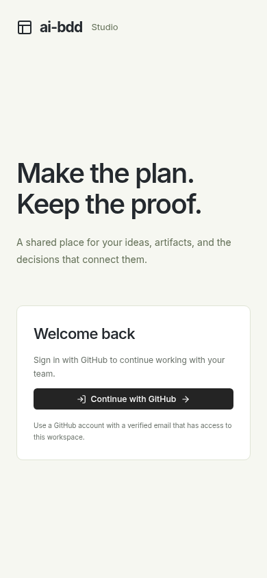

# Deployed GitHub-only sign-in

Source: `0837738a2c1611517a0abb7f7231513571e843dc`.

These actual anonymous preview captures show one **Continue with GitHub** action and no username, password or setup forms. The action fits the desktop and mobile viewports. Both images were opened and reviewed; TLS verification remained enabled. The capture clicked no sign-in action, created no application session, sent no model requests and made no page mutations.

Separate hosted HTTP checks passed eight checks: health/readiness, GitHub-only status, password/setup/demo refusal without a session, anonymous identity refusal, and the actual managed authorization start with the exact callback, PKCE, nonce and browser binding. Credentials, authorization URLs and operational resource identifiers stay private.

This verifies the deployed login UI and authorization start. A real account consent, callback, authenticated session and production acceptance are still separate gates.

