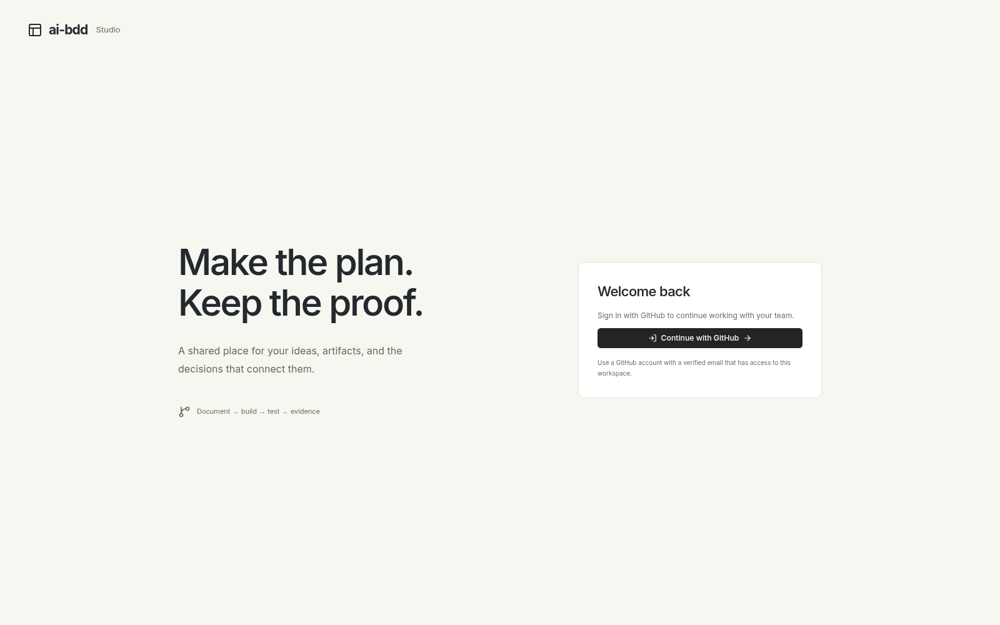

# Anonymous production GitHub sign-in UI

Fresh anonymous captures from the public production application at source [`f7ce9ae`](https://github.com/Tyler-R-Kendrick/ai-bdd/commit/f7ce9aea561c4ddc16ac38be0127c3b55214b5c2). Both images show one **Continue with GitHub** action and no credential forms. The action fits the desktop and mobile viewports.

The capture used valid TLS and a fresh browser, without authentication headers, existing profiles or cookies. It did not click the GitHub action, start OAuth, perform a callback, authenticate a person, or call a model. Both images were opened and visually reviewed; neither contains identity data.

Separate production HTTP verification passed eight checks: health, readiness, GitHub-only authentication status, refusal of password/setup/demo sign-in, anonymous identity refusal, and a real managed authorization start with the correct callback, OAuth/PKCE and browser binding. [Verification](verification.json) records the source, image hashes and dimensions, and those aggregate results.

**A completed real-user GitHub callback and login remain unverified.** These images and checks establish the anonymous production UI and authorization start.
