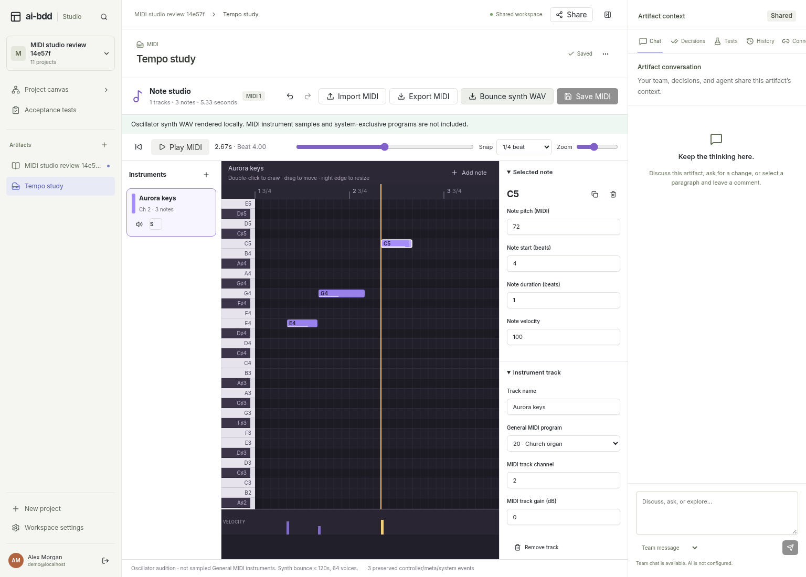
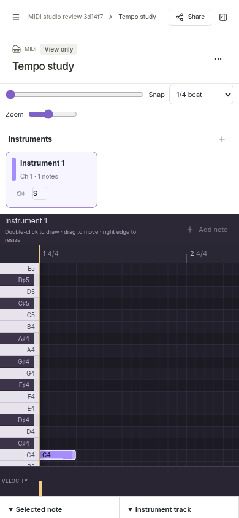

# MIDI authoring evidence

Captured on 2026-10-30 with actual Chromium and the authenticated Studio application. Feature source: `3b11be3711044f2586a5f6fc2bad65866a5e65d6`; integrated source: `29eabea35304ab3f69ffb13060f98976196c250c`. The browser host includes the dedicated MIDI dispatch from `e0a3a44` and the shared SMF codec fixes from `51ede48`.

The desktop capture shows a saved three-note arrangement, its selected C5 note, General MIDI program 20/channel 2, tempo-aware playhead, velocity lane, and artifact conversation. The WAV completion notice follows an actual successful local render.

The mobile capture shows a signed-in viewer at 390 px width after the sidebar transition settles. The view-only badge and disabled note editing agree with the server's 403 response to a mutation request. The piano roll retains its own scrolling; the page has no horizontal overflow.

## Executed checks

The [browser acceptance suite](../../../packages/studio/tests/midi-editor.spec.ts) passed two real browser workflows, including physical note drawing, dragging, resizing and undo; program/channel/tempo/meter/velocity edits; authenticated save/reload; seek/play; retained local conflict drafts; viewer protection; and desktop/mobile layout. Both workflows asserted no HTTP 500 responses or uncaught browser exceptions.

Fourteen [editor/performance](../../../packages/studio/tests/midi-editor.test.ts) and [independent SMF codec](../../../packages/studio/tests/midi-codec.test.ts) checks passed, along with whole-Studio TypeScript and owned-file lint checks. The SMF decoder used by the tests is the independent `midi-file` package. Exported WAV data was independently decoded with FFprobe and FFmpeg, then measured from PCM samples.

The [retained measurements](export-probe.json) record:

- A 150-byte imported SMF remained byte-for-byte identical after save/reload and export, including its original running status and metadata. Focusing an unchanged imported tempo field did not alter its precision or dirty the artifact.
- The edited 162-byte SMF decoded to notes 64/67/72 at ticks 480/960/1920, velocities 88/55/100, and channel 1 (zero-based). Program 19, the 3/4 meter and SysEx were also independently checked.
- The oscillator WAV is stereo PCM16 at 44,100 Hz, with duration 5.423356 s (the eight-beat score at nominal 90 BPM, SMF microsecond tempo quantization, and its release tail).
- Decoded PCM RMS was 0 in the silent intro and tail, 0.0101136 for the quieter note, and 0.0247573 for the louder note. The louder/quieter ratio is approximately 2.448.
- The C5 component at 523.25 Hz had measured power 0.000251166. Its power exceeded the 440 Hz comparison by at least 10× in the 2.9–3.1 s interval.

## Fixture and rendering scope

The project, users and musical data are synthetic acceptance fixtures. These images show the actual running product; they do not represent a live AI provider, hosted rendering service or hardware MIDI device.

The Web Audio oscillator synth provides audition and offline WAV bounce, rather than a sampled General MIDI sound bank. Its common controller support and fixed two-semitone pitch-bend range do not claim full external-instrument or SysEx emulation. All retained MIDI controller/meta/system data remains available to SMF export. Edited SMF exports omit muted/unsoloed parts because SMF has no standard per-track mute state; the saved native arrangement retains those notes.

Synth bounce is bounded to 120 seconds and 64 simultaneous voices including release tails, with a controller-work budget enforced before audio allocation. Longer or denser projects remain editable and exportable as MIDI. Shared source limits include 32 logical tracks, 10,000 notes and 10,000 preserved events, 4096 beats, 256 tempo changes, 128 meter changes, 512,000 preserved data bytes, and a 10 MiB imported file. Decoder and synth bounds are separate and are enforced by their respective schemas and runtimes.

## Artifact integrity

| File                | SHA-256                                                            |
| ------------------- | ------------------------------------------------------------------ |
| `desktop.png`       | `1adbff76c825fd8f96ead6e420d347b2686eccfaf8330917eeb1ab0ab630bcb1` |
| `mobile-viewer.png` | `4c36ade500532d078c948fa046e839d0e2efd18bffe38e59474a6238821085de` |
| `export-probe.json` | `9d976549779dc6508aabacd3aa14f8958ebf6ed1c65c69433fb58d7fd5fe472c` |
