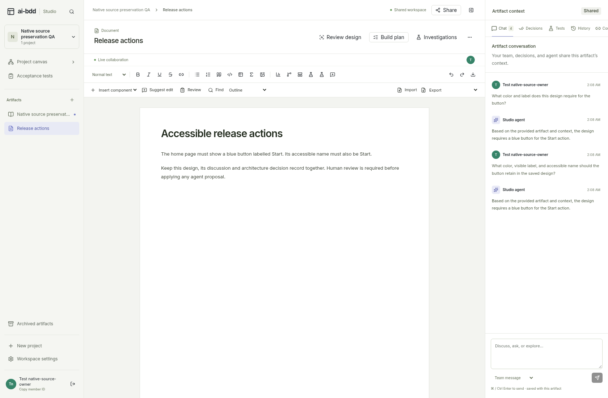
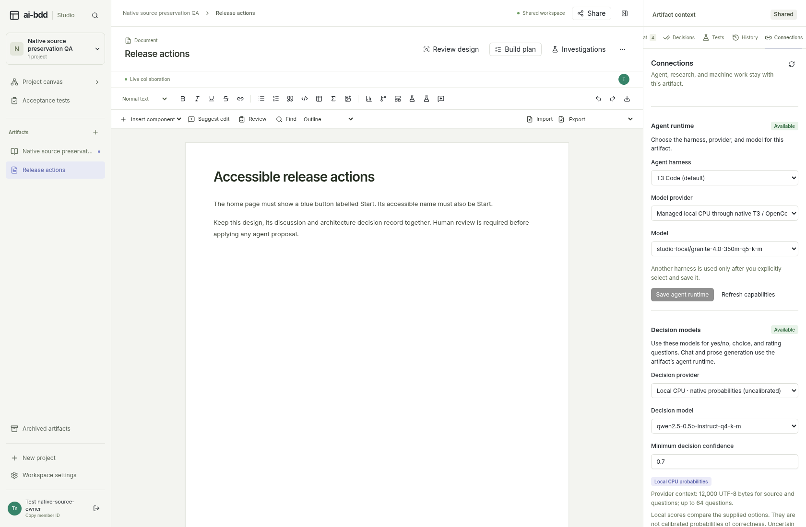
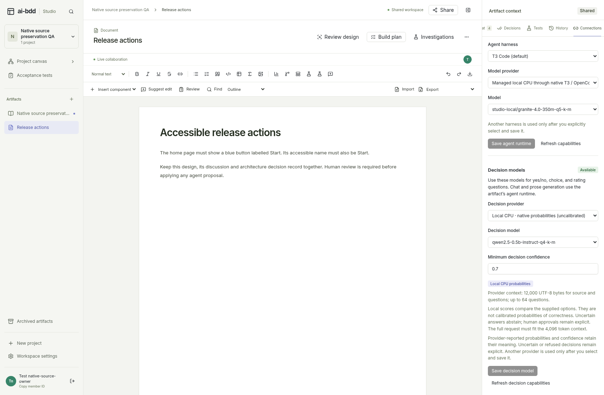

# Native function protocol evidence

The native T3 bridge carries typed tools, calls, and results through the Vercel AI SDK. The SDK owns bounded, authorized tool execution; native T3/OpenCode effect tools remain disabled. Optional free local Granite and Qwen3 registration is separate from qualification for artifact edits. The default Qwen2.5 chat model and independent decision configuration remain unchanged.

These are distinct checks, not a claim that all authoring workflows are qualified:

| Source | Actual case | Result |
| --- | --- | --- |
| `ce6ba1d` | Automatic repository read | Failed: the model supplied an absolute `/tmp/` path. The repository boundary rejected it before I/O. |
| `b929a8d` | Automatic repository read with the shared production path contract | Passed: actual repository tool read and answer grounded in its returned bytes; two SDK steps. |
| `155c250` | Two saved-document chat turns | Passed: both real replies retained blue and Start; the saved artifact/version, ADR, and thread remained linked and unchanged. |
| `155c250` | Structured code-edit proposal | Failed: the response supplied ADR-shaped content. Validation rejected it before publishing or applying a proposal; the first attempt was cancelled before retry. |
| `da15784` | Controlled SDK/Agent edit-contract regressions | Passed: the trusted artifact kind now supplies the output schema and the exact latest human edit request is quoted explicitly. This is controlled protocol evidence, not a new model-quality result. |
| `c8e6335` | Typed code-edit proposal | Failed: the model retained Start, overescaped HTML quotes, removed a saved trailing newline, and added an unintended file. The exact source assertions stopped before human application; canonical source remained unchanged. |
| Literal code-patch contract | Controlled SDK/Agent regressions | Passed: model-backed code edits reconstruct complete proposals from bounded literal operations over frozen source. Actual model results are recorded separately below. |
| `7064960` | Native admission for the literal-patch request | Failed before any CPU worker or model call: native OpenCode auto-compacted the bulk envelope and changed its framing. Exact request validation rejected it. A separate zero-model diagnostic verified the transformation. |
| Managed request-reference contract | Controlled SDK/MCP regressions | The managed transport now launches a short scoped reference and keeps complete typed SDK data server-side. This is controlled protocol evidence; weighted authoring on this transport has not been qualified. |
| `93d5a8b`, Granite | Literal code-patch request | Failed after one actual CPU generation: the output included a missing literal in `notes.txt`. No assistant proposal or source change was published. Independent replay rejects that literal; cancellation overwrote the initial job error, so no retained runtime stack is claimed. |
| `93d5a8b`, default Qwen2.5 | Separate model assessment on the same edit task | Failed after one actual CPU generation: all paths were absolute, with additional unwanted edits. No proposal or application occurred. Independent replay rejects the paths; the initial runtime error was overwritten by cancellation. |
| `d63614c`, default Qwen2.5 | Source-bound path enum contract | Failed after one actual CPU generation: filenames now matched the saved artifact, but unwanted replacements remained and the fifth literal was absent. The output passes the new schema; independent reconstruction replay rejects the missing literal. Source remained unchanged, with no proposal or application. |
| `5cd7e84`, optional Qwen3 | Separate subject with the original 1 GiB worker guard | Resource admission failed during context creation before prefill or decode. One CPU request produced zero completed generations and zero text. This is not a model-quality result. Source remained unchanged; no proposal, application or preview occurred. |
| `4c5ea4a`, optional Qwen3 | New registered 1.5 GiB resource variant | Inference completed within its bounds. The plan contained the desired Start-to-Launch replacement and a redundant identity replacement whose find text was absent from `notes.txt`. The then-current reconstruction contract rejected it. No proposal or application occurred. Independent replay confirms that rejection; the retained pre-cancellation error is the framework's generic retry notice. |
| Validated identity contract | Controlled SDK/Store/owner-apply regressions | After complete schema, path, original-scope, conflict and request-bound validation, replacements with identical find and replacement values are ignored because they cannot change bytes. Missing text for non-identity replacements and whole-result no-ops remain errors. This is a new contract, not a relabeling of the preceding failed case. |
| `908c617`, optional Qwen3 | New identity-aware contract | Failed: the model proposed meaningful, unwanted color and style changes. The helper correctly ignored the identity replacement, then rejected a later non-identity missing literal. Source remained unchanged, with no proposal, application or preview. Its edit capability is disabled. |
| Official Qwen2.5-Coder-1.5B registration | Controlled registry and resource-policy checks | A separate code-specific subject is registered with immutable public file pins and the existing 1.5 GiB ceiling. These checks do not establish a completed download, generation, successful edit or production availability; each requires its separate receipt. |
| `ca6c590`, code-specific Coder | Separate fully verified subject using non-mapped loading | The complete file passed size, SHA-256 and embedded-header checks. Actual loading then exhausted the fixed 2 GiB container: its retained OOM event matches the worker's SIGKILL before model-loaded, prefill or decode. There was no text, proposal, application or preview. This is a resource result, not an edit-quality assessment. |
| Registered mapped-loading variant | Controlled parent/worker and preparation checks | Only the pinned Coder subject uses memory-mapped, verified read-only weights. All memory, CPU, context and output limits remain unchanged. The earlier allocation failure remains failed; controlled loading-mode checks do not establish successful actual inference. |
| `df18a61`, mapped Coder under the previous capacity | Separate actual mapped-loading case | Actual IPC and three worker phase flags confirmed the requested mapped-loading mode. Before model-loaded or generation, a direct RSS sample of 1,755,877,376 bytes exceeded the 1,610,612,736-byte worker ceiling. Source remained unchanged; no text, proposal, application or preview occurred. The sample is not a continuous peak and says nothing about edit quality. |
| Prepared Pro Performance profile | Controlled resource-policy and sample configuration checks | The existing active Pro plan supports a separate 4 GiB/two-CPU target. Only Coder receives a 2,560 MiB worker ceiling; prior smaller-model limits remain unchanged. This new profile still requires actual qualification and explicit deployment configuration; it does not relabel earlier one-CPU/2 GiB failures. |
| `45a4b1f`, Coder on Pro capacity | Separate one-proposal actual case | Resources fit: inference completed with two-core affinity and the registered 2.5 GiB ceiling. The desired first replacement was followed by an overlapping escaped literal absent from the original source. Reconstruction rejected it; source remained unchanged, with no proposal, application or preview. No strings were unescaped or edits rewritten. |
| Bounded mechanical repair workflow | Controlled SDK, durable receipt and owner-apply tests | At most two SDK proposal rounds use the same captured profile and original source. Only typed missing-literal or conflict errors permit the second round. Empty/unchanged plans and exhaustion terminate; resource, refusal and authorization errors do not trigger repair. This is a new workflow awaiting its separate actual assessment. |

Model-backed code editing through T3, Vercel/fx, and local CPU now uses explicit replace/create/delete operations and an optional entry update. Exact replacements apply to all non-overlapping literal matches and preserve untouched bytes by construction. Fully validated identity replacements are ignored; non-identity missing text, conflicting operations, invalid paths, excessive output and unchanged final results are rejected. The normal version/content proposal, independent Store validation, source/ACL fences, and human application remain in place. Attached RemotePlanner integrations retain their existing separately validated text/content wire contract.

Managed native requests use a domain-separated keyed reference bound to the artifact, profile, durable request key, and complete CPU-effective SDK data. Exact-one matching, native provider/mode guards, typed tool/result validation, input/resource limits, and native effect-tool denial remain in force. A separate transport namespace isolates older bulk-envelope checkpoints. External three-argument T3 integrations retain their existing wire format; decision fingerprints and defaults are unchanged.

Model-backed code edit schemas now enumerate only the selected saved artifact's filenames for replace/delete operations. Create paths advertise relative syntax, while independent schema and reconstruction checks still reject existing, reserved or traversing paths. Native decoding constrains existing-file enum choices; it does not enforce every string pattern or prove the requested edit's semantics. The current [validated proposal contract](../../studio-code-edit-contract.md) uses `model-output-code-patch-v4` and separate raw-plan round receipts, isolating earlier contracts. Every cached plan is independently reconstructed before publication. Controlled SDK/API coverage and actual model outcomes remain separate evidence.

Repair uses ordinary typed conversation history: the original user prompt, bounded prior assistant plan as untrusted data, and trusted mechanical feedback. It neither normalizes invalid strings nor switches models. Both rounds retain the existing six-step limit for bounded repository tools; two proposal rounds do not imply at most two underlying provider requests when tools are used. Infrastructure recovery before a receipt commits remains separately bounded by the job runtime. The no-repository assessment can explicitly bound its CPU generation count to two.

The cases through `5cd7e84` used a 1 GiB worker RSS guard. The separately identified `4c5ea4a` variant used the registered 1.5 GiB Qwen3 guard. All retained a true single-CPU affinity, 4,096-token context, 1,024-token output, 45-second CPU-request deadline, 2 GiB whole-container limit and 120-second case bound. Saved-source chat used exactly two actual Granite calls and zero decision calls; it completed in 47.05 seconds. Its largest observed worker diagnostic RSS was 654,938,112 bytes. Diagnostic RSS is sampled rather than a continuous peak measurement.

The [registered memory policy](../../studio-adr-local-model-memory.md) keeps the original smaller models at 1 GiB and Qwen3 at 1.5 GiB. Coder's earlier 1.5 GiB allocation results are recorded above. The separately prepared [Pro capacity profile](../../studio-adr-pro-model-capacity.md) assigns Coder a 2.5 GiB ceiling within a 4 GiB/two-CPU host. Context, output, request and case deadlines remain unchanged. Resource admission and edit quality are separate; the code-specific subject still requires actual qualification before release. No previous failure is retried or relabeled as a pass.

The [mapped-loading decision](../../studio-adr-mapped-model-loading.md) changed only Coder's registered I/O strategy. Parent and worker bind that flag to the same immutable file identity, and mapped files must pass the existing path and full-checksum checks plus read-only permissions. That failed case kept its original capacity. The later Pro capacity decision is separate; neither changes precision or introduces runtime downloads or model fallback.

## Actual saved-source conversation

This screenshot restores the actual closed SQLite database and both owned object files from the completed `155c250` case. It shows both generated replies beside the original document. The separate normal Studio UI capture performed zero model calls, made no API writes, and checked that the saved source, version, ADR, threads, messages, jobs, decision-call rows, native-state rows, and owned objects remained unchanged.

Authentication for this model fixture used an owned in-process code/PKCE issuer through the real Auth routes, followed by a fresh session bound to the same persisted GitHub principal. This is not evidence of upstream GitHub/Connect HTTP or production browser login.

## Explicit agent profile and separate decision profile

The fixture explicitly selects T3 Code and `studio-local/granite-4.0-350m-q5-k-m`. Qwen remains selected for independent decisions; Granite is excluded from decision-model options. Neither the weighted source-chat case nor this capture executed a decision model. Production defaults were not changed.

All three screenshots are unaltered 1,680 × 1,100 Chromium captures, visually reviewed against their captions. The capture reused an existing verified client built at prior auth commit `bbef421`; it did not rebuild the client. Capture occurred while the main checkout was at `a587709`. The tracked client/shared/build/lock inputs are byte-identical across `bbef421`, `a587709`, and the qualified `155c250` source. The later edit-contract fix is a separate commit.

| PNG | SHA-256 |
| --- | --- |
| `native-t3-granite-retained-blue-start-chat.png` | `ba3845576b7767ff0fe8551912cdeb586dc6f37521f42d0014240d5be5e8c11e` |
| `native-t3-granite-explicit-runtime-picker.png` | `97fac9f726a62bb846b00419820cc6b7546e1be6207ed757e6ec5d6fb01780f7` |
| `native-t3-independent-qwen-decision-picker.png` | `f15a03cdd58d0bac2756b6e1a8aa6007e3802f3269d9aadbf50ead1902cd100a` |

The public evidence deliberately excludes SQLite files, session cookies, state keys, capsules, and raw private model-transport receipts.
